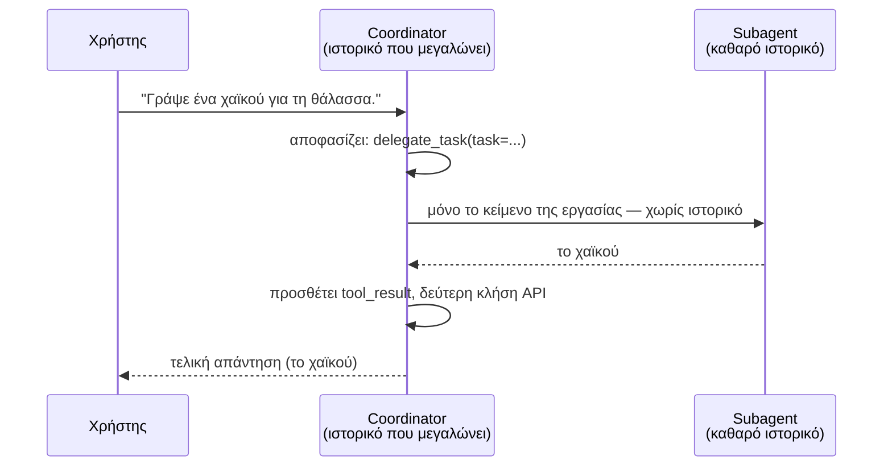

# Ο Coordinator και ο Subagent (απλή εξήγηση)

*Πώς μια συνομιλία με το Claude αναθέτει μια εργασία σε μια εντελώς ξεχωριστή συνομιλία — από το `3_coordinator_agent_subagent/main.py`.*

## Σε 2 λεπτά

- Ο coordinator έχει ένα μόνο εργαλείο: `delegate_task`.
- Όταν το καλέσει, ο κώδικας **δεν** τρέχει μια απλή τοπική συνάρτηση (όπως `add_two_numbers`). Αντ' αυτού, κάνει μια **δεύτερη, εντελώς ανεξάρτητη κλήση `messages.create()`** — με δικό της system prompt και άδεια λίστα μηνυμάτων.
- Αυτή η δεύτερη κλήση *είναι* ο subagent. Δεν ξέρει καν ότι υπάρχει coordinator· βλέπει την εργασία σαν να είναι το μοναδικό μήνυμα που έλαβε ποτέ.
- Η απάντηση του subagent επιστρέφει στον coordinator ως `tool_result`, και ο coordinator τη μεταφέρει στον χρήστη.
- Συνολικά 3 κλήσεις στο Claude API, μέσα σε **δύο ξεχωριστά ιστορικά συνομιλίας**.

## Η βασική ιδέα

Στο [`1_stop_reason_tool_call`](../1_stop_reason_tool_call/round-trip.md) υπήρχε μία συνομιλία και μία συνάρτηση που έτρεχε τοπικά. Στο [`2_desicion_making`](../2_desicion_making/decision-tree.md) υπήρχε πάλι μία συνομιλία — απλώς η απόφαση ήταν υποχρεωτική αντί για προαιρετική. Εδώ μπαίνει μια δεύτερη, πραγματικά ξεχωριστή συνομιλία με το Claude, και το ερώτημα-κλειδί γίνεται: **τι επιτρέπεται να δει ο subagent;**

Η απάντηση: τίποτα, εκτός από το κείμενο της εργασίας. Αυτό δεν είναι περιορισμός — είναι το νόημα. Ένας subagent με καθαρό, στενό context:

- δεν μπερδεύεται από άσχετο ιστορικό της συνομιλίας του coordinator
- μπορεί να έχει τελείως διαφορετικό system prompt / "χαρακτήρα", φτιαγμένο ειδικά για τη δουλειά του
- θα μπορούσε, σε θεωρία, να τρέξει σε μικρότερο και φθηνότερο μοντέλο, αφού δεν χρειάζεται όλη τη "σκέψη" του coordinator — τίποτα σε αυτό το μοτίβο δεν απαιτεί να χρησιμοποιούν το ίδιο μοντέλο

Το Anthropic SDK δεν ξεχωρίζει τεχνικά ποια κλήση είναι "coordinator" και ποια "subagent" — αυτή η ιεραρχία υπάρχει μόνο στον τρόπο που είναι οργανωμένος ο δικός σου κώδικας Python. Ένας subagent είναι απλώς μια κλήση `messages.create()` που γίνεται *μέσα από έναν tool handler*, με τη δική της καθαρή λίστα `messages`.

## Η ροή



## Βήμα-βήμα, με πραγματικό output

Όλα όσα ακολουθούν είναι από ένα πραγματικό τρέξιμο (`uv run main.py`). Κώδικας και τερματικό δείχνονται μαζί.

### Βήμα 1 — Το αίτημα του χρήστη

```python
messages = [
    {"role": "user", "content": "Write a haiku about the ocean."},
]
```

Απλώς μια λίστα με ένα μήνυμα. Δεν έχει γίνει ακόμα καμία κλήση στο API.

### Βήμα 2 — Ο coordinator αποφασίζει να αναθέσει

```python
response = await client.messages.create(
    model=MODEL,
    max_tokens=1024,
    system=COORDINATOR_SYSTEM,
    messages=messages,
    tools=tools,
)
```

```text
[
  {
    "id": "toolu_01PgPJngEMo4SzxpnxXjzxu2",
    "input": {
      "task": "Write a haiku (5-7-5 syllable structure) about the ocean. Provide just the haiku as the final output."
    },
    "name": "delegate_task",
    "type": "tool_use"
  }
]
```

Δύο πράγματα αξίζει να προσέξεις:

- **Ο coordinator δεν γράφει ποτέ ο ίδιος το χαϊκού.** Το `COORDINATOR_SYSTEM` του το απαγορεύει, και το σέβεται — όλη η απάντηση είναι ένα μόνο `tool_use` block, χωρίς καθόλου κείμενο.
- **Ξαναδιατύπωσε την εργασία πριν την αναθέσει.** Το αρχικό μήνυμα ήταν *"Write a haiku about the ocean."* Αυτό που στέλνεται τελικά στον subagent είναι *"Write a haiku (5-7-5 syllable structure) about the ocean. Provide just the haiku as the final output."* — ο coordinator πρόσθεσε μόνος του τον κανόνα 5-7-5 συλλαβών και οδηγία για τη μορφή του output. Αυτό δείχνει στην πράξη τη βασική ιδέα: επειδή ο coordinator ξέρει ότι ο subagent ξεκινάει από άδειο context, φροντίζει να του δώσει εκ των προτέρων ό,τι θα χρειαστεί, χωρίς να υποθέτει κοινή γνώση.

### Βήμα 3 — Το "πέρασμα σκυτάλης": μια ολοκαίνουρια κλήση API

```python
messages.append({"role": "assistant", "content": response.content})

for block in tool_use_blocks:
    if block.name == "delegate_task":
        result_text = await run_subagent(client, **block.input)
```

```python
async def run_subagent(client: AsyncAnthropic, task: str) -> str:
    response = await client.messages.create(
        model=MODEL,
        max_tokens=1024,
        system=SUBAGENT_SYSTEM,
        messages=[{"role": "user", "content": task}],
    )
    result_text = next(block.text for block in response.content if block.type == "text")
    return result_text
```

```text
>>> Ο subagent ξεκινά την εργασία: 'Write a haiku (5-7-5 syllable structure) about the ocean...'
<<< Ο subagent τελείωσε: 'Endless blue whispers\nWaves crash against ancient stone\nSalt air fills the sky'
```

Αυτό είναι μια *τρίτη*, εντελώς ξεχωριστή συνομιλία, με τη δική της λίστα `messages`. Δεν υπάρχει κανένα ιστορικό του coordinator μέσα της — βλέπεις μόνο τι μπαίνει (`task`) και τι βγαίνει (το χαϊκού).

### Βήμα 5 — Το αποτέλεσμα επιστρέφει στον coordinator

```python
tool_results.append({
    "type": "tool_result",
    "tool_use_id": block.id,
    "content": result_text,
})
messages.append({"role": "user", "content": tool_results})
```

```text
[
  { "role": "user", "content": "Write a haiku about the ocean." },
  {
    "role": "assistant",
    "content": [
      {
        "id": "toolu_01PgPJngEMo4SzxpnxXjzxu2",
        "input": { "task": "Write a haiku (5-7-5 syllable structure)..." },
        "name": "delegate_task",
        "type": "tool_use"
      }
    ]
  },
  {
    "role": "user",
    "content": [
      {
        "type": "tool_result",
        "tool_use_id": "toolu_01PgPJngEMo4SzxpnxXjzxu2",
        "content": "Endless blue whispers\nWaves crash against ancient stone\nSalt air fills the sky"
      }
    ]
  }
]
```

Το `tool_use_id` στο τρίτο μήνυμα ταιριάζει ακριβώς με το `id` του δεύτερου — αυτό είναι το "νήμα" που επιτρέπει στον coordinator να συνδέσει "αυτό που ζήτησα" με "η απάντηση που πήρα", παρόλο που η πραγματική δουλειά έγινε σε μια κλήση που ο ίδιος δεν βλέπει άμεσα. (Δεν υπάρχει τυπωμένο "Βήμα 4" — αυτό είναι το εσωτερικό round trip του subagent από το Βήμα 3, μέσα σε μια συνομιλία που η λίστα `messages` του coordinator δεν αγγίζει ποτέ.)

### Βήμα 6 — Η τελική απάντηση του coordinator

```python
response = await client.messages.create(
    model=MODEL,
    max_tokens=1024,
    system=COORDINATOR_SYSTEM,
    messages=messages,
    tools=tools,
)
```

```text
Τελική απάντηση στον χρήστη: Here's a haiku about the ocean:

Endless blue whispers
Waves crash against ancient stone
Salt air fills the sky
```

Ο coordinator δεν επαναλαμβάνει απλώς το χαϊκού του subagent — το "ντύνει" με μια εισαγωγική φράση ("Here's a haiku about the ocean:"). Ο subagent παρήγαγε το *περιεχόμενο*· ο coordinator παρήγαγε την *παρουσίαση προς τον χρήστη*. Αυτός ο διαχωρισμός — η μία κλήση κάνει τη δουλειά, η άλλη αποφασίζει πώς θα παρουσιαστεί — είναι όλο το νόημα του μοτίβου.

## Σύγκριση των τριών φακέλων μέχρι τώρα

| Φάκελος | # συνομιλιών | Ποιος αποφασίζει το αποτέλεσμα | Ποιος τρέχει το "εργαλείο" |
|---|---|---|---|
| `1_stop_reason_tool_call` | 1 | Το Claude, προαιρετικά (`tool_choice: auto`) | Μια τοπική συνάρτηση Python |
| `2_desicion_making` | 1 | Το Claude, υποχρεωτικά (`tool_choice: any`) | Μια τοπική συνάρτηση Python ανά κλάδο |
| `3_coordinator_agent_subagent` | **2** | Το Claude (coordinator), μετά ξανά το Claude (subagent) | Μια **δεύτερη κλήση στο Claude API** |

## Τι ακολουθεί

Αυτό είναι σκόπιμα η πιο απλή δυνατή εκδοχή: ένας coordinator, ένας subagent, μία εργασία, καθόλου παραλληλισμός. Τα φυσικά επόμενα βήματα — ένας coordinator που αναθέτει σε *πολλούς* subagents ταυτόχρονα, ή subagents που τρέχουν σε φθηνότερο μοντέλο από τον coordinator — είναι ακριβώς αυτό που αυτοματοποιεί η λειτουργία `multiagent` των Managed Agents της Anthropic, στην πλευρά του server. Εδώ κάνεις το ίδιο πράγμα με το χέρι, με μία κλήση συνάρτησης να αντικαθιστά ολόκληρο το feature της πλατφόρμας.

## Σε μία γραμμή

Ένας subagent δεν είναι κάποιο ειδικό feature της πλατφόρμας — είναι μια απομονωμένη κλήση `messages.create()`, με δικό της system prompt, που καλείται μέσα από έναν tool handler αντί από το κύριο script σου.
