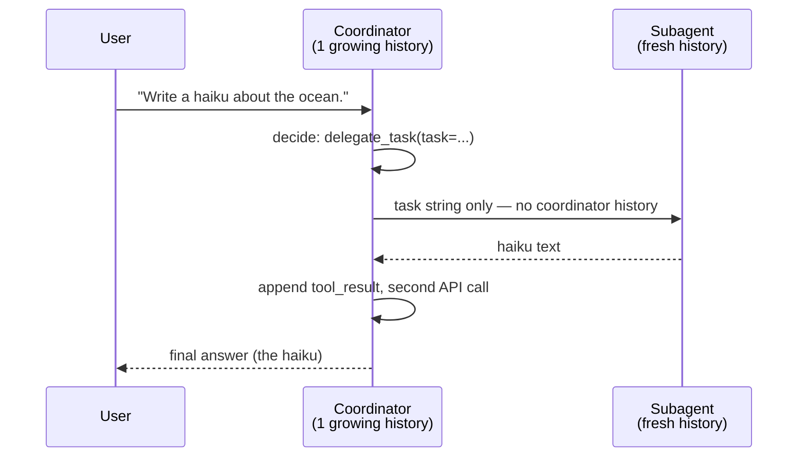

# The Coordinator and the Subagent

*How one Claude conversation delegates a task to a completely separate one — from `3_coordinator_agent_subagent/main.py`.*

## TL;DR

- The coordinator has one tool: `delegate_task`.
- When it's called, your code doesn't run a local function like `add_two_numbers` — it fires a **second, independent `messages.create()` call**, with its own system prompt and its own empty `messages` list.
- That second call *is* the subagent. It has no idea a coordinator exists; it just sees the task as if it were the only message ever sent.
- The subagent's answer is handed back to the coordinator as a `tool_result`, and the coordinator relays it to the user.
- Three Claude API calls total, across **two separate conversation histories**.

## The mindset shift

[`1_stop_reason_tool_call`](../1_stop_reason_tool_call/round-trip.md) had one conversation and one function that ran on your machine. [`2_desicion_making`](../2_desicion_making/decision-tree.md) still had one conversation — it just forced a decision instead of leaving it optional. This file introduces a second, genuinely separate Claude conversation, and the entire design problem becomes: **what does the subagent get to see?**

The answer here: nothing except the task string. That's not a limitation — it's the point. A subagent with a fresh, narrow context:

- can't get confused by irrelevant history from the coordinator's conversation
- can run on a completely different system prompt / persona, tuned for its one job
- could, in principle, run on a smaller and cheaper model, since it doesn't need the coordinator's full reasoning ability — nothing in this pattern requires both calls to use the same model

Nothing in the Anthropic SDK marks one call as "the coordinator" and another as "the subagent" — that hierarchy exists purely in how your Python code is organized. A subagent is just a `messages.create()` call made *from inside a tool handler*, with its own clean `messages` list.

## The flow



## Step by step, with real output

Everything below is from one actual run (`uv run main.py`). Code and terminal output are shown together so you can trace exactly which line produced which line.

### Step 1 — The user's request

```python
messages = [
    {"role": "user", "content": "Write a haiku about the ocean."},
]
print_json("Step 1: user request to the coordinator", messages)
```

```text
--- Step 1: user request to the coordinator ---
[
  {
    "role": "user",
    "content": "Write a haiku about the ocean."
  }
]
```

Just a one-turn list. Nothing has touched the API yet.

### Step 2 — The coordinator decides to delegate

```python
response = await client.messages.create(
    model=MODEL,
    max_tokens=1024,
    system=COORDINATOR_SYSTEM,
    messages=messages,
    tools=tools,
)
print_json("Step 2: coordinator's response", response.content)
```

```text
--- Step 2: coordinator's response ---
[
  {
    "id": "toolu_01PgPJngEMo4SzxpnxXjzxu2",
    "caller": {
      "type": "direct"
    },
    "input": {
      "task": "Write a haiku (5-7-5 syllable structure) about the ocean. Provide just the haiku as the final output."
    },
    "name": "delegate_task",
    "type": "tool_use"
  }
]
```

Two things worth noticing:

- **The coordinator never writes a haiku itself.** `COORDINATOR_SYSTEM` told it not to, and it obeys — the whole response is a single `tool_use` block, no text at all.
- **It rewrote the task before delegating it.** Your original message was *"Write a haiku about the ocean."* What actually gets sent to the subagent is *"Write a haiku (5-7-5 syllable structure) about the ocean. Provide just the haiku as the final output."* — the coordinator added the 5-7-5 constraint and an output-format instruction on its own. This is the mindset section above showing up in practice: because the coordinator knows the subagent starts from a blank context, it front-loads everything the subagent will need instead of assuming shared understanding.
- `caller: {"type": "direct"}` is response metadata newer SDK versions attach to `tool_use` blocks, marking that Claude called the tool directly (as opposed to programmatically, from inside a code-execution script). Safe to ignore for this pattern.

### Step 3 — The hand-off: a brand new API call

```python
messages.append({"role": "assistant", "content": response.content})

for block in tool_use_blocks:
    if block.name == "delegate_task":
        result_text = await run_subagent(client, **block.input)
```

```python
async def run_subagent(client: AsyncAnthropic, task: str) -> str:
    print(f"\n>>> Subagent starting task: {task!r}")
    response = await client.messages.create(
        model=MODEL,
        max_tokens=1024,
        system=SUBAGENT_SYSTEM,
        messages=[{"role": "user", "content": task}],
    )
    result_text = next(block.text for block in response.content if block.type == "text")
    print(f"<<< Subagent finished: {result_text!r}")
    return result_text
```

```text
>>> Subagent starting task: 'Write a haiku (5-7-5 syllable structure) about the ocean. Provide just the haiku as the final output.'
<<< Subagent finished: 'Endless blue whispers\nWaves crash against ancient stone\nSalt air fills the sky'
```

This is the only part of the run that isn't wrapped in `print_json` — not because it's less important, but because it's a *third*, entirely separate conversation with its own `messages` list, so there's no coordinator-shaped history to log. All you see is what goes in (`task`) and what comes out (the haiku). If you wanted to inspect the subagent's raw `response.content` too, you could drop a `print_json` call inside `run_subagent` — it would show a single `text` block, structured just like the coordinator's Step 6 below.

### Step 5 — Reporting the result back to the coordinator

```python
tool_results.append({
    "type": "tool_result",
    "tool_use_id": block.id,
    "content": result_text,
})
messages.append({"role": "user", "content": tool_results})
print_json("Step 5: messages sent back to the coordinator", messages)
```

```text
--- Step 5: messages sent back to the coordinator ---
[
  {
    "role": "user",
    "content": "Write a haiku about the ocean."
  },
  {
    "role": "assistant",
    "content": [
      {
        "id": "toolu_01PgPJngEMo4SzxpnxXjzxu2",
        "caller": {
          "type": "direct"
        },
        "input": {
          "task": "Write a haiku (5-7-5 syllable structure) about the ocean. Provide just the haiku as the final output."
        },
        "name": "delegate_task",
        "type": "tool_use"
      }
    ]
  },
  {
    "role": "user",
    "content": [
      {
        "type": "tool_result",
        "tool_use_id": "toolu_01PgPJngEMo4SzxpnxXjzxu2",
        "content": "Endless blue whispers\nWaves crash against ancient stone\nSalt air fills the sky"
      }
    ]
  }
]
```

`tool_use_id` in the third turn matches `id` in the second turn exactly — that's the thread letting the coordinator connect "the thing I asked for" to "the answer I got back," even though the actual work happened in a call it never sees directly. (There's no "Step 4" printed in the log — it's the subagent's own internal round trip from Step 3, happening inside a conversation the coordinator's `messages` list never touches.)

### Step 6 — The coordinator's final answer

```python
response = await client.messages.create(
    model=MODEL,
    max_tokens=1024,
    system=COORDINATOR_SYSTEM,
    messages=messages,
    tools=tools,
)
print_json("Step 6: coordinator's final response", response.content)

for block in response.content:
    if block.type == "text":
        print("\nFinal answer to user:", block.text)
```

```text
--- Step 6: coordinator's final response ---
[
  {
    "citations": null,
    "text": "Here's a haiku about the ocean:\n\nEndless blue whispers\nWaves crash against ancient stone\nSalt air fills the sky",
    "type": "text"
  }
]

Final answer to user: Here's a haiku about the ocean:

Endless blue whispers
Waves crash against ancient stone
Salt air fills the sky
```

The coordinator doesn't just echo the subagent's haiku back verbatim — it wraps it with a one-line lead-in ("Here's a haiku about the ocean:"). The subagent produced the *content*; the coordinator produced the *user-facing framing* around it. That split — one call does the work, the other decides how to present it — is the whole point of the pattern.

## Comparing the three folders so far

| Folder | # of conversations | What decides the outcome | What runs the "tool" |
|---|---|---|---|
| `1_stop_reason_tool_call` | 1 | Claude, optionally (`tool_choice: auto`) | A local Python function |
| `2_desicion_making` | 1 | Claude, forced (`tool_choice: any`) | A local Python function per branch |
| `3_coordinator_agent_subagent` | **2** | Claude (coordinator), then Claude again (subagent) | A **second Claude API call** |

## Where this goes next

This is deliberately the simplest possible version: one coordinator, one subagent, one task, no parallelism. The natural next steps — a coordinator that delegates to *several* subagents at once, or subagents that run on a cheaper model than the coordinator — are exactly what Anthropic's Managed Agents `multiagent` roster automates on the server side. Here, you're doing the same thing by hand, with one function call standing in for the whole platform feature.

## One-line takeaway

A subagent is not a platform feature — it's an isolated `messages.create()` call with its own system prompt, invoked from inside a tool handler instead of from your top-level script.
